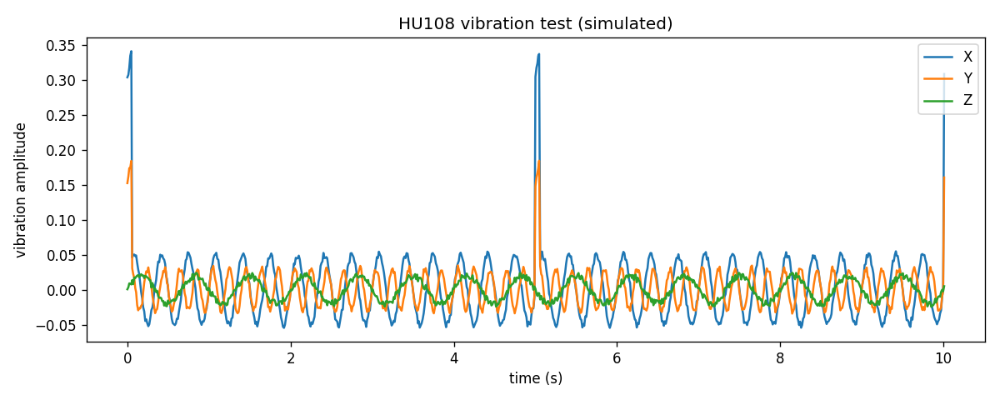
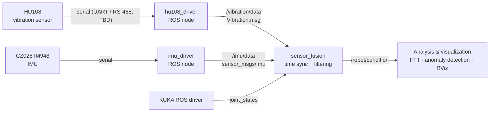

# ROS Multi-Sensor Condition Monitoring for an Industrial Robot


A ROS 1 framework for **acquiring, time-stamping, synchronizing and analyzing vibration and IMU data** from a KUKA industrial robot, as groundwork for **condition monitoring and predictive maintenance**.

Sensors: **HU108** three-axis vibration sensor and **CZ028 IM948** IMU. Robot joint states come from the KUKA ROS driver.

<p align="center">
  
  <br><sub>Phase 1 acquisition pipeline running on a simulated HU108 signal (3 / 5 / 1.5 Hz on X / Y / Z, with an injected impact every 5 s).</sub>
</p>

## Why

Vibration on a robot's joints and base changes as motors, gears and bearings wear. Logging it **on the same clock as the robot's joint states** lets you link a spike in the signal to what the robot was doing at that moment. That link is the starting point for anomaly detection and maintenance scheduling.

## Architecture



Design choices:
- **Standard messages where possible.** The IMU publishes `sensor_msgs/Imu` on `/imu/data`, so packages like `robot_localization` work without changes.
- **A `Header` on every sample.** `stamp` + `frame_id` are the basis for synchronizing with KUKA joint states.
- **Prove the acquisition outside ROS first.** Each sensor is read in plain Python (serial → CSV → plot) before it is wrapped in a ROS node.

Details: [docs/system_architecture.md](docs/system_architecture.md)

## Quick start: run the acquisition pipeline without hardware

```bash
git clone https://github.com/greenaandblue/ROS-based-Multi-Sensor.git
cd ROS-based-Multi-Sensor/hardware/HU108/scripts
pip install matplotlib pyserial

python3 hu108_test.py --simulate --duration 10        # synthetic signal, no sensor needed
python3 hu108_test.py --port /dev/ttyUSB0 --baud 115200 --duration 10   # real HU108
```

Each run writes `test_data.csv` (`timestamp,x,y,z`) and a waveform plot `test_data.png`.

`--simulate` swaps the serial port for `mock_serial.MockHU108Serial`, a drop-in fake with the same `readline()` interface. It emits a **known** signal, so the pipeline can be checked against ground truth. A 3 s run gave 298 samples with a mean interval of 10.1 ms (designed: 10 ms / 100 Hz). [docs/testing_guide.md](docs/testing_guide.md) explains what the simulated test proves, what it can't, and how to judge real sensor data (noise floor, tap response, axis independence).

## Roadmap

| Phase | Milestone | Status |
|---|---|---|
| 0 | Hardware selection, architecture, message design | ✅ Done |
| 1 | HU108 serial read → CSV → plot (no ROS) | 🟡 Pipeline verified in simulation; real frame format TBD |
| 2 | `hu108_driver` ROS publisher (`Vibration.msg`) | ⬜ |
| 3 | `Header` time stamps + `frame_id` | ⬜ |
| 4 | `imu_driver` publishing `/imu/data` | ⬜ |
| 5 | Synchronize vibration + IMU + KUKA `joint_states` | ⬜ |
| 6 | Filtering, FFT and anomaly / condition-monitoring demo | ⬜ |

Open items: confirm the HU108 interface (UART vs RS-485), baud rate and frame format; confirm the IM948 output mode and rate; choose the KUKA driver that provides `joint_states`.

## Repository structure

```
├── docs/
│   ├── system_architecture.md    Data flow, ROS package layout, message design, phases
│   ├── testing_guide.md (.pdf)   How to verify the pipeline vs. the sensor (EN + 中文)
│   └── experiment_log.md         Dated log template
├── hardware/
│   ├── HU108/                    Datasheet notes, protocol notes, scripts/
│   │   └── scripts/              hu108_test.py, mock_serial.py, sample CSV + plot
│   └── CZ028_IM948/              Datasheet and protocol notes
└── ros_ws/                       Catkin workspace (Phase 2+); Vibration.msg draft
```

Draft message (`ros_ws/Vibration.msg`):

```
Header header
float32 acceleration_x
float32 acceleration_y
float32 acceleration_z
float32 amplitude
float32 velocity
```

## Tech stack

Ubuntu 20.04 · ROS Noetic · Python 3 (pyserial, Matplotlib) · C++ · Arduino / STM32 (optional serial bridge) · KUKA ROS driver

## Author

**Huihang Liu** · Computer Engineering, Penn State · [@greenaandblue](https://github.com/greenaandblue)
